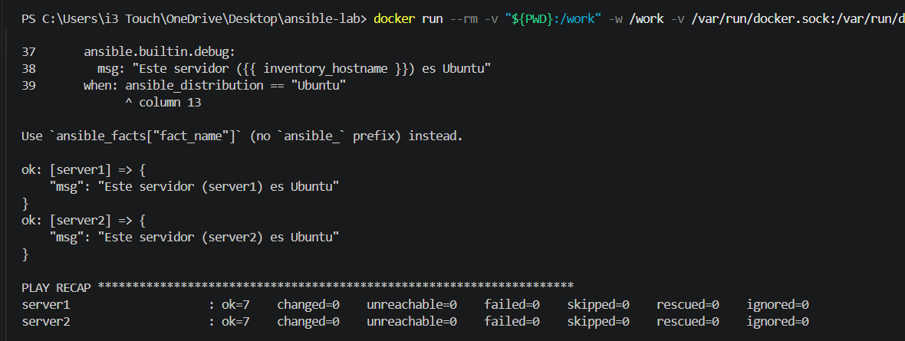

# Práctica 2do Parcial: Ansible con Docker

## Objetivo
Crear un laboratorio con dos servidores Linux (Ubuntu 24.04) usando Docker y administrarlos con Ansible mediante un inventario y un playbook.

## Iniciar los contenedores
```bash
docker compose up -d
docker ps
docker exec server1 bash -c "apt update && apt install -y python3"
docker exec server2 bash -c "apt update && apt install -y python3"
```

## Comprobar la conexión
```bash
ansible docker -i inventory.ini -m ping
```

## Ejecutar el playbook
```bash
ansible-playbook -i inventory.ini playbook.yml
```

## Captura de la ejecución exitosa

